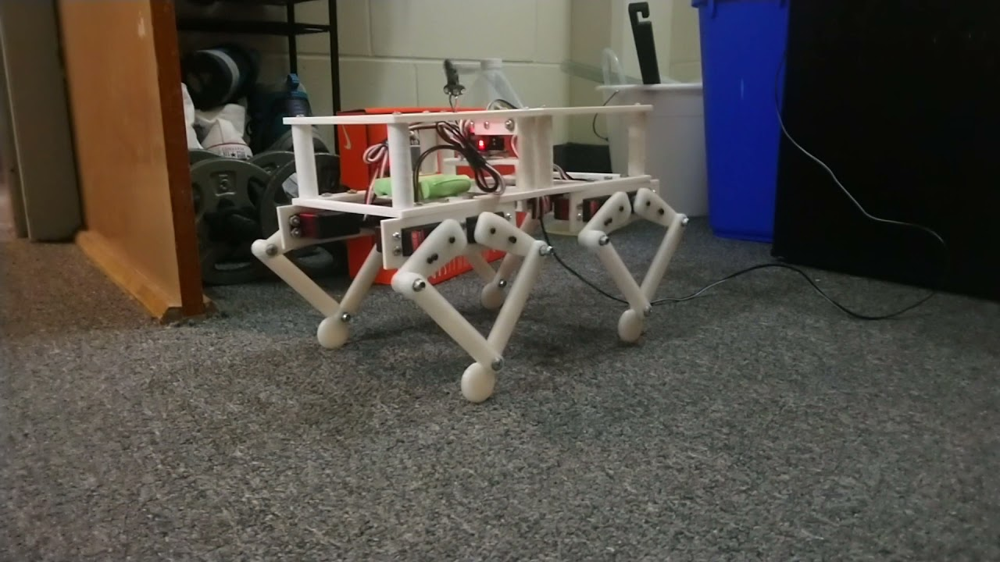
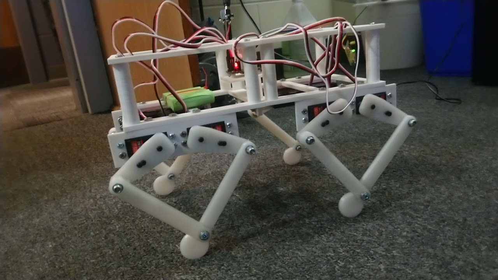
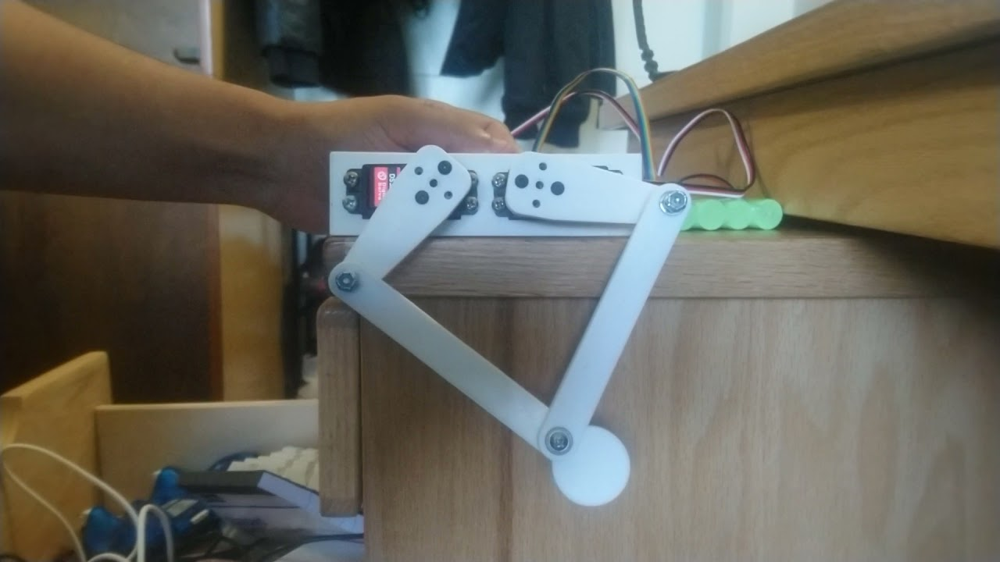

# Quadruped Robot

A four-leg walking robot built as an undergraduate research project in CS224. Each leg is a five-bar linkage driven by two hobby servos. The firmware on a Silicon Labs BGM13P22 solves the inverse kinematics and plays a trot. The board also carries an LIS2DW12 accelerometer for the balance work described in the talk.

Hung Cao. Advisor: Dr. Sergei Bezroukov, Math and Computer Science Department.

<p>
  
  
</p>

The finished walker, from the build videos. The first still is the [side view](https://youtu.be/-NH-mS7NlNQ) on 7 August 2020. The second is the [three-quarter view](https://youtu.be/phx6AxvB4AU).

<p>
  
</p>

One leg on the bench, before the other three were fitted. [That clip](https://youtu.be/0Er2zEz7mTY) is the five-bar the gait math is written for.

The research talk, with the build photos, is in [Quadruped Robot.pptx](Quadruped%20Robot.pptx). An illustrated walkthrough, with the build videos and diagrams of the leg and the trot, is in [docs/GUIDE.md](docs/GUIDE.md).

## Videos

| Clip | What the frame shows |
| --- | --- |
| [One leg on the bench](https://youtu.be/0Er2zEz7mTY) | The five-bar linkage before the other legs were added. |
| [Assembled robot, side view](https://youtu.be/-NH-mS7NlNQ) | All four legs, 7 August 2020, powered through a lead. |
| [Assembled robot, three-quarter view](https://youtu.be/phx6AxvB4AU) | Servo wiring, the green pack, and the same linkages. |

## What the firmware does

`app.c` is the program that ran on the robot.

1. `initHardware()` brings up I2C, the accelerometer, the 50 Hz PWM timers, and a LETIMER used for delays. Deep sleep is forced off so the PWM keeps running.
2. The four legs move to a standing calibration pose and hold it for 5 seconds.
3. A trot loop then runs forever. Every 1 ms the phase advances by π/64, a new foot target is computed for each leg, and `calculateAngle()` turns that target into two servo angles.

Diagonal pairs move together. Legs 1 and 4 share one phase. Legs 2 and 3 share the opposite phase. That is the trot.

The foot path in the same units as the linkage is:

```text
x = 2 * sin(phase) + 2
y = 0.25 * cos(phase) - 10
```

The opposite pair uses `phase + π`.

## Inverse kinematics

`calculateAngle()` treats the leg as a five-bar. Two servos sit 4 units apart. The squared lengths in the formula are 25 and 100, so the links are 5 and 10 in those same units. Both joint results are in degrees:

```text
delta1 = arccos(-x / hypot(x, y))
       - arccos((x² + y² + 25 - 100) / (10 * hypot(x, y)))

delta2 = arccos((x - 4) / hypot(x - 4, y))
       - arccos(((x - 4)² + y² + 25 - 100) / (10 * hypot(x - 4, y)))
```

Each leg then adds its own zero offset, because the servos were mounted at slightly different angles. `widthPulse()` converts degrees to a pulse width:

```text
pulse_ms = angle_deg * 0.00733 + 1.0
```

`setPWMPulseWidth()` loads that width into the timer compare register. The carrier is 50 Hz (`PWM_FREQ`), with the timer prescaled by 16.

## Servo map

Eight channels, two per leg. Pins are the PWM nets on [schema.png](schema.png). Offsets are the calibration angles in `appMain()`.

| Leg | Joint | Timer channel | Pin | Standing angle | Trot sign |
| --- | --- | --- | --- | --- | --- |
| 1 | hip | TIMER0 CC0 | PA1 | 85° | `+ delta1` |
| 1 | knee | TIMER0 CC1 | PA2 | 80° | `- delta2` |
| 2 | hip | WTIMER0 CC0 | PA3 | 90° | `- delta1` |
| 2 | knee | WTIMER0 CC1 | PA4 | 98° | `+ delta2` |
| 3 | hip | TIMER1 CC0 | PF5 | 93° | `+ delta1` |
| 3 | knee | TIMER1 CC1 | PF4 | 80° | `- delta2` |
| 4 | hip | TIMER1 CC2 | PF3 | 87° | `- delta1` |
| 4 | knee | TIMER1 CC3 | PF2 | 95° | `+ delta2` |

Legs 2 and 4 use the opposite sign so the mirrored mounts still move the foot the same way.

`servoSweep()` can move one of those eight channels from a start angle to an end angle over a timed window. The call site in `appMain()` is commented out. The trot loop is the path that runs.

## Hardware

Custom board, drawn in `robot.brd` and [schema.png](schema.png). Photographs of the bare board are `PCB_top.jpg` and `PCB_bottom.jpg`. The purchased parts are listed in `BOM.xlsx`.

| Part | Role |
| --- | --- |
| BGM13P22F512GA | Bluetooth SoC. Runs the gait and can run the Silicon Labs radio stack. Programmed through the SWD header. |
| LIS2DW12 | Accelerometer on I2C0 at 400 kHz. SDA is PC9, SCL is PC10, interrupt is PC11. The order line in the BOM is the LIS2DTW12TR, the temperature variant of this part. |
| TPS62172 | Buck regulator to 3.3 V for the MCU and sensor. The servos are not powered from this rail. |
| Eight hobby servos | Two per leg, PWM at 50 Hz. |
| Four snap-action switches | Foot or leg contacts. Firmware enables pull-ups on PD15, PA0, PF5, and PF6, then configures PF5 as a servo output, so that switch is not read while the gait runs. |
| Chassis and legs | Printed parts, designed in Inventor, as described in the talk. |

The talk records the practical limits of this build: the battery could not carry an untethered run, so the robot was powered from a wall adapter, and the servos were not fast enough for a jump or a flip.

## What is initialized and what the loop uses

The accelerometer is initialized with `LIS2DW12_setup()`. `LIS2DW12_getData()` is commented out, so the trot does not yet correct itself from measured acceleration. Closing that loop was the stated next step in the talk.

The file includes the Silicon Labs Bluetooth headers (`native_gecko.h`, `gatt_db.h`). `gecko_init()` is commented out, so this copy of `app.c` does not advertise or accept phone commands. The Simplicity Studio project in `Robot.zip` still has a GATT database from the Bluetooth SDK example (device information, OTA, current time, and a custom weather service). The device name in that database is the course template name, "Sergei's Server". Walk commands from the EFR Connect app were part of the project plan. They are not wired to the gait in the firmware published here.

## Repository layout

| Path | What it is |
| --- | --- |
| `app.c` | Leg firmware: hardware init, inverse kinematics, calibration pose, and trot. |
| `schema.png`, `robot.brd` | Schematic and board. |
| `PCB_top.jpg`, `PCB_bottom.jpg` | Fabricated board. |
| `BOM.xlsx` | Purchased parts. |
| `Quadruped Robot.pptx` | Research talk: goal, method, results, and the balance work left to do. |
| `Robot.zip` | Simplicity Studio project for the BGM13, including the Bluetooth GATT files and a build tree. It is an archive of the IDE project, not a second robot design. |

## Build

This repository is not a standalone GCC project. `app.c` is the application file inside a Silicon Labs Bluetooth SDK example for the BGM13P22, opened in Simplicity Studio. The SDK headers (`em_timer.h`, `native_gecko.h`, `LIS2DW12.h`, and the board support package) come from that SDK, which is packaged inside `Robot.zip` together with the object files from the last build.

To rebuild: unzip `Robot.zip`, open the `Robot` project in Simplicity Studio with the Bluetooth SDK that matches this BGM13 example, and keep `app.c` as the application. Flash through the SWD header.

## Scope

This is an embedded leg controller: trigonometry, servo timing, and a sensor on a custom board. It is not a PLC program, and it does not include ladder logic, structured text, or an industrial fieldbus.
