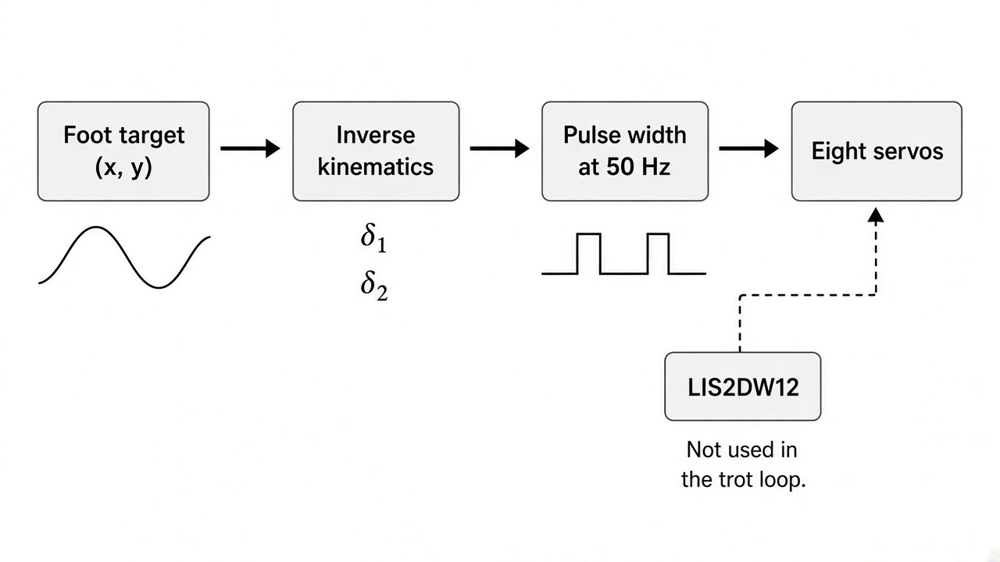
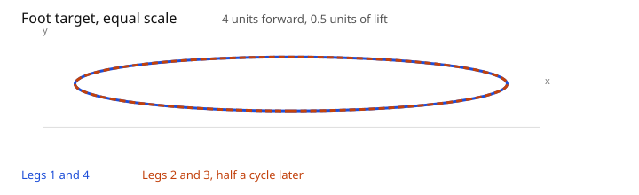
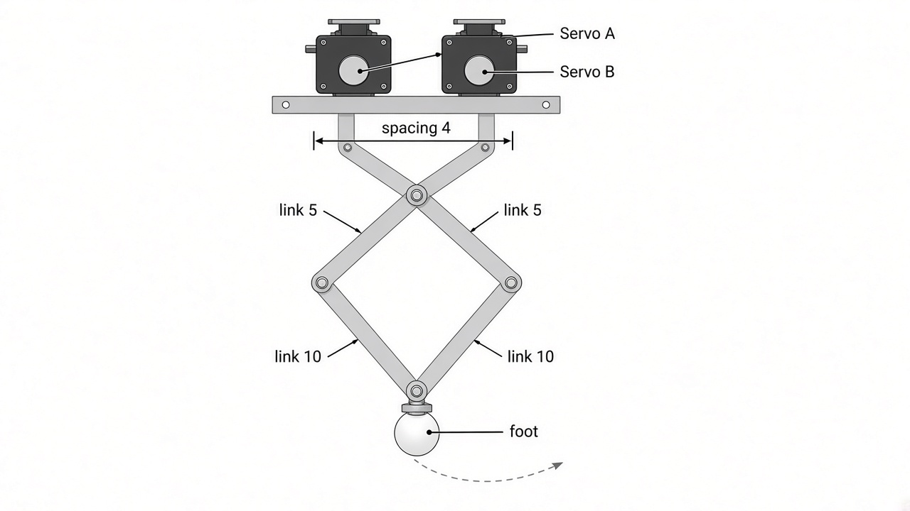
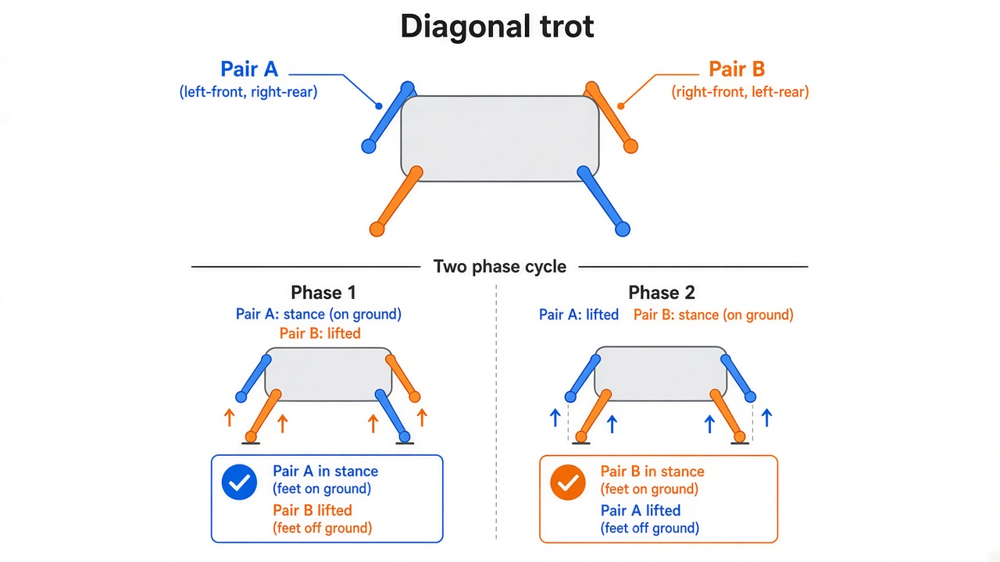
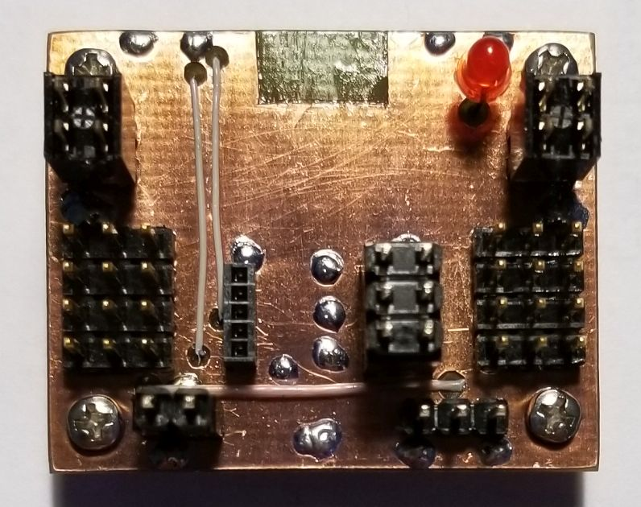
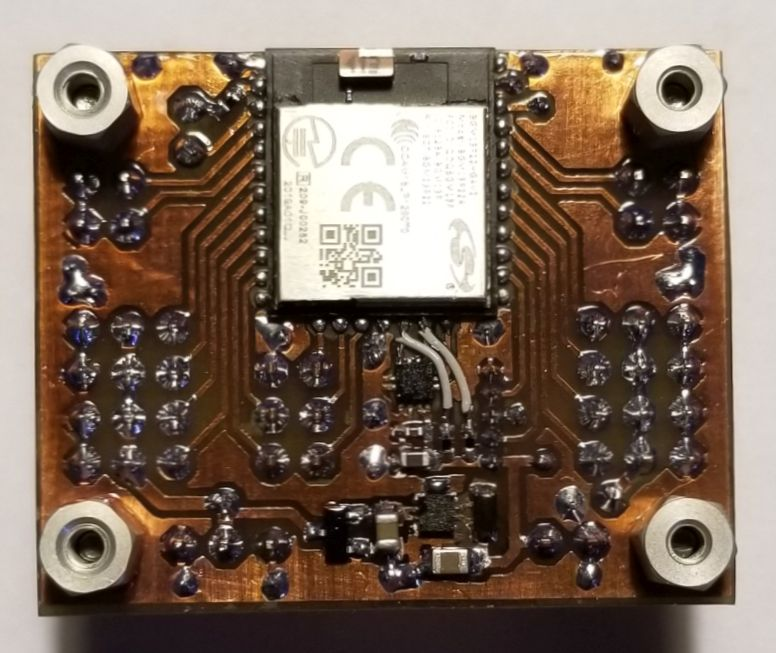

# Quadruped robot

How the machine is built, how one step is computed, and the videos of the leg and the finished walker. The pin table, the inverse-kinematics formula, and the build instructions stay in the [README](../README.md).

The drawings in `docs/images/` are illustrations of the firmware. They are not photographs. The photographs are the video stills and the pictures of the board.

## Videos

Three clips from the build. The still under each link is the public poster frame.

### One leg on the bench

[MOV 1468](https://youtu.be/0Er2zEz7mTY)


This is the first mechanism: two servos on a rail, four printed links, and a round foot. The research plan was to get one leg moving before the other three were added.

### Assembled robot, side view

[TRIM 20200807 214543](https://youtu.be/-NH-mS7NlNQ)


The frame is dated 7 August 2020. All four legs are on the chassis. A lead leaves the robot for power, which matches the talk: the battery could not run the robot on its own, so it was powered from a wall adapter. The red light is the indicator on the controller.

### Assembled robot, three-quarter view

[MOV 1483](https://youtu.be/phx6AxvB4AU)


The same walker from the front corner. Each leg is the bench linkage, repeated. The servo leads come back to the controller, and a green pack sits in the frame.

## From a foot target to a pulse



Each millisecond the firmware picks a point `(x, y)` on a small loop, converts it to two joint angles, and turns those angles into servo pulses.

```text
x = 2 * sin(phase) + 2
y = 0.25 * cos(phase) - 10
pulse_ms = angle_deg * 0.00733 + 1.0
```

The pulse is a 50 Hz signal. `0°` is about 1.0 ms. The LIS2DW12 accelerometer is initialized on the board, and the trot does not read it. The dashed arrow in the drawing is that unused path. Balance was the next step named in the talk.

The curve below uses the same scale on both axes. The step is 4 units long and only 0.5 units tall, so the foot slides forward more than it lifts.



Legs 1 and 4 follow the solid curve. Legs 2 and 3 follow the same shape half a cycle later.

## One leg



The printed leg in the bench video is a five-bar. Two servos are the driven joints. The distance between those joints is the `4` in `calculateAngle()`. The `5` and `10` are the link lengths used in the law of cosines (`25` and `100` are their squares). The round part at the bottom is the foot.

`calculateAngle()` returns `delta1` and `delta2` in degrees. Each leg adds its own standing offset, because the servos were not mounted at the same angle. Legs 2 and 4 also flip the sign so a mirrored mount still moves the foot the same way. The offsets and the timer pins are in the [README servo table](../README.md#servo-map).

## Diagonal trot



A trot lifts diagonal feet together. In `app.c` that pairing is:

| Pair | Legs | Phase |
| --- | --- | --- |
| A | 1 and 4 | `phase` |
| B | 2 and 3 | `phase + π` |

The drawing names those pairs A and B. Which corner of the chassis is leg 1 is set by the wiring: legs 1 and 2 are the TIMER0 and WTIMER0 plugs on PA1–PA4, and legs 3 and 4 are the TIMER1 plugs on PF2–PF5.

After the 5 second standing pose, `phase` advances by π/64 every millisecond, so one full cycle is 128 ms. The outer loop does not stop.

## The board

The controller is a custom board. The copper photographs are the real PCB. The schematic is [schema.png](../schema.png).



The top side is mostly connectors. Servo plugs, the programming header, and the red LED land here. The large copper area is the hand-finished board.



The bottom carries the BGM13P22 Bluetooth module, the TPS62172 regulator that makes 3.3 V, and the small parts around the LIS2DW12. Four metal standoffs hold this board in the printed frame. The part list is [BOM.xlsx](../BOM.xlsx).

```text
foot target → calculateAngle() → widthPulse() → 50 Hz PWM → two servos per leg
                     ↑
               BGM13P22
                     ↑
         LIS2DW12 on I2C (initialized, not read by the trot)
```

## Where the details live

| Question | Where |
| --- | --- |
| Joint angles, pins, and the exact formula | [README](../README.md) |
| Why the project was built, and what was left unfinished | [Quadruped Robot.pptx](../Quadruped%20Robot.pptx) |
| One leg, then the whole robot | The three videos above |
| Rebuild | Simplicity Studio project inside [Robot.zip](../Robot.zip) |

Phone commands and active balance are described in the talk. They are not what `app.c` runs in the loop that produces the trot.
